[Portfolio](https://me.th33raphat.dev/) · [CV](https://me.th33raphat.dev/cv.pdf) · [LinkedIn](https://linkedin.com/in/theeraphat-chueanokkhum) · [Email](mailto:th33raphat@gmail.com)

Chaiyaphum, Thailand (UTC+7). Open to freelance work and full-time roles.

---

### What I can take on

| Layer | What I do | Daily tools |
|---|---|---|
| **Interface** | Turn operational workflows into screens with clear states and fast feedback | Next.js, Angular, TypeScript, Figma |
| **Services** | APIs, background jobs and integrations shaped around the real workflow | NestJS, FastAPI, Node.js, Python |
| **Data** | Contracts, migrations and the edge cases behind production records | Oracle, PostgreSQL, SQL |
| **Platform** | Package, deploy, observe and operate what I build | Kubernetes, ArgoCD, Harbor, Vault |

I stay with the software after launch: incident triage, root-cause reports, release scope and QA evidence are part of the job.

### Working with AI agents

I run Claude Code across the whole delivery path and package what works as skills, so the agent follows the same steps I would: spec and tests before code, a scored design review, QA evidence, and infra changes closed with a report.

### Selected work

| Project | Role | What it is |
|---|---|---|
| **OCM: Oil Control Management** | End to end, 2024 to now | Nationwide oil-control system for the Excise Department, microservices on Kubernetes |
| **SGT Fumigation** | Full stack | Lets fumigation technicians file daily reports from the field instead of on paper |
| **Morya** | QA and backend | Ongoing testing and backend work on a company website |
| **The Horotoday** | Web app | Scroll-driven site where the motion is the product |
| **U Work** | UX/UI design | Job-matching app, from research and flows to final screens |
| **Makro Assessment** | Web app | Quality-control platform used daily in Makro and Lotus's stores |

Client work is private. Details are on the [portfolio](https://me.th33raphat.dev/).

### Open source

| Repo | What it does |
|---|---|
| [th3-skills](https://github.com/th3r-dev/th3-skills) | Claude Code skills I use at work: design review, QA, DevOps, PoC builds, PDF tools |
| [mullion](https://github.com/th3r-dev/mullion) | Rust. Use Android tablets as extra monitors for Windows, macOS and Ubuntu |
| [piewall](https://github.com/th3r-dev/piewall) | Python. Manage Windows Firewall rules from a small window or the command line |
| [th3-plug](https://github.com/th3r-dev/th3-plug) | Plugins for the DeepSeek harness: run shell commands from the chat box |
| [cavimg](https://github.com/th3r-dev/cavimg) | Go. Render images to canvas so they can't be dragged or copied |
| [safe-stringify](https://github.com/th3r-dev/safe-stringify) | TypeScript. Stringify any object, including circular references and DOM nodes |

### Stack

| Area | Tools |
|---|---|
| Frontend | Next.js, Angular, React, Tailwind CSS, TypeScript |
| Backend | NestJS, FastAPI, Express, Node.js, .NET, Python |
| Data | Oracle, PostgreSQL, MongoDB, SQL Server, Redis |
| Platform | Kubernetes, VMware Tanzu, ArgoCD, Harbor, Vault, Docker, Podman, Nginx Ingress, Avi Load Balancer |
| CI/CD | GitLab CI, GitHub Actions |
| Cloud | GCP, AWS, Alibaba Cloud |
| Mobile | Flutter, Dart |
| AI and automation | Claude Code, n8n, Ollama, Roboflow |
| QA | Playwright, Jest, Robot Framework, Postman, Bruno |
| Design | Figma, Blender |
